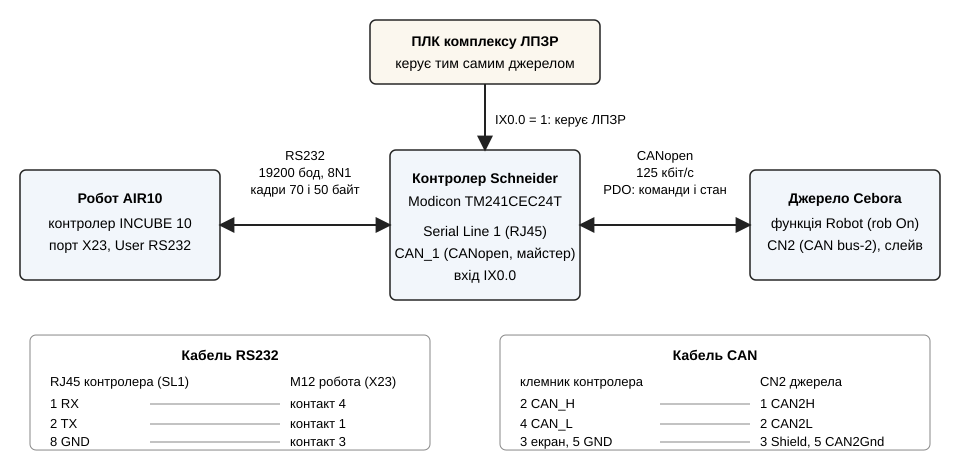
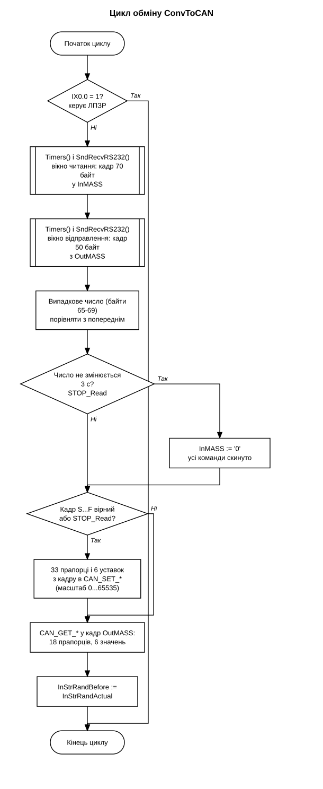
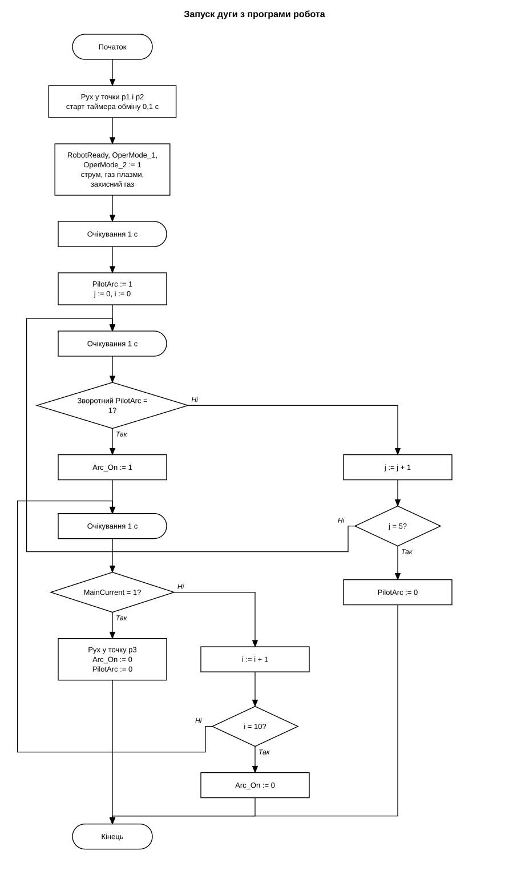

# ROBOT_RS232_SCHNEIDER_CAN_CEBORA

Керування джерелом живлення Cebora для плазмового зварювання від робота через контролер Schneider TM241.
Робот обмінюється з контролером ASCII-кадрами по RS232. Контролер перетворює команди в PDO і передає їх джерелу по CANopen, а стан джерела повертає роботу.



## Обладнання і ПЗ

| Вузол | Що |
|---|---|
| Контролер | Schneider Modicon TM241CEC24T/U |
| Джерело | Cebora, слейв CANopen, роз'єм CN2 (CAN bus-2), EDS `CEBORA_TIG.eds` |
| Робот | AIR10, контролер INCUBE 10, програма у файлах `.arl`, порт X23 (User RS232) |
| Зв'язок з роботом | RS232, Serial Line 1 контролера (RJ45), 19200 бод, 8 біт, без парності, 1 стоп-біт |
| Зв'язок з джерелом | CANopen, CAN_1, 125 кбіт/с, контролер майстер (Node ID 100), джерело слейв (Node ID 3) |
| Середовище | SoMachine Logic Builder V4.3, Structured Text і FBD, бібліотеки SE_TBX (Toolbox) і PLCCommunication |
| Стенд | скетч Arduino імітує робота, `tools/robot_simulator` |

Схема кабелю RS232: `docs/rs232-wiring.png`.

## Як працює обмін

Робот періодично надсилає контролеру кадр 70 байт: 33 прапорці команд, 6 уставок і випадкове число. Контролер відповідає кадром 50 байт: 18 прапорців стану і 6 виміряних значень.

Зі змінних кадру контролер формує вихідні змінні `CAN_SET_*`. Вони відображені на PDO джерела. Стан джерела приходить у змінні `CAN_GET_*` і потрапляє у відповідь роботу.

Уставки перераховуються лінійно у слово 0...65535: струм 0...500 А, швидкість дроту -10...10 м/хв, коефіцієнт імпульсу 0...100 %, витрата плазмового газу 0...10 л/хв, витрата захисного газу 0...30 л/хв.

Повні таблиці байтів, прапорців і масштабів: [docs/protocol.md](docs/protocol.md).

## Захист і спільна робота з комплексом ЛПЗР

Випадкове число в кадрі змінюється в кожному обміні. Якщо воно не змінюється 3 с (таймер `T4`), контролер скидає всі команди і джерело зупиняється. Так обробляється вимкнення робота, аварійний стоп або обрив кабелю.

Те саме джерело може керуватись від ПЛК комплексу ЛПЗР (репозиторій [LPWCC](https://github.com/vomolexandr/LPWCC)). Коли цей ПЛК подає сигнал на вхід `IX0.0`, контролер припиняє обмін з роботом і не змінює команди джерела. Без сигналу керування повертається роботу.

## Програми контролера

| Файл | Призначення |
|---|---|
| `ConvToCAN.st` | розбір кадру від робота, масштабування уставок, формування `CAN_SET_*`, формування кадру відповіді з `CAN_GET_*`, захист за випадковим числом, перевірка `IX0.0` |
| `SndRecvRS232.st` | читання і запис по Serial Line 1 (`ADDM`, `SEND_RECV_MSG`), виконана в графічному редакторі FBD |
| `Timers.st` | таймери вікон читання і запису та таймер захисту `T4` на 3 с, виконана в FBD |
| `GVL.st` | вхід `IX0.0`, буфери кадрів, змінні `CAN_SET_*` і `CAN_GET_*`, змінні таймерів |

Відображення змінних `CAN_SET_*` і `CAN_GET_*` на PDO налаштоване у вузлі `CEBORA_TIG_PS` дерева пристроїв:


## Програма робота

Бібліотека `robot/Cebora.arl` формує кадр, виконує обмін і розбирає відповідь.

| Функція | Призначення |
|---|---|
| `Cebora::SET("Parameter", 0 або 1)` | дискретний параметр, наприклад `RobotReady`, `PilotArc`, `Arc_On` |
| `Cebora::SET_WeldCurrent(i)` | струм зварювання, 0...500 А |
| `Cebora::SET_WireHighSpd(d)`, `SET_WireLowSpd(d)` | швидкість дроту, -10.0...10.0 м/хв |
| `Cebora::SET_PLS_Ratio(i)` | коефіцієнт імпульсу, 0...100 % |
| `Cebora::SET_PlasmaGasFlow(d)`, `SET_ShieldGasFlow(d)` | витрата плазмового і захисного газу, л/хв |
| `Cebora::GET("Parameter")` | стан або вимір, повертається рядок |
| `Cebora::main()` | один обмін, викликається по перериванню таймера |

Приклад:

```
import "/USB/sda1/Cebora/Cebora.arl"

Cebora::SET("RobotReady", 1)
Cebora::SET("OperMode_1", 1)
Cebora::SET("OperMode_2", 1)
Cebora::SET_WeldCurrent(75)
print "Voltage = " + Cebora::GET("WeldVoltage") + ", V"
```

Програма `robot/Ctrl_via_CANopen.arl` запускає чергову і основну дугу з перевіркою зворотних сигналів, виконує рух і має переривання по кнопці F1 та датчику зіткнення. Опис програмування: [docs/robot-guide.md](docs/robot-guide.md).

## Алгоритм

Цикл обміну в контролері:



Запуск дуги з програми робота:



## Налаштування джерела і контролера

- На джерелі увімкнена функція Robot (`rob On`).
- У технічному меню джерела: функція `CAn` у режимі `SL` (слейв), швидкість `Cbr` 125 кбіт/с, ID джерела `CId` 3, ID керуючого пристрою `CMI` 100.
- Термінальний резистор: перемикач SW2 джерела в положенні ON (CN2 зайнятий), перемикач LT контролера в положенні ON.
- Кабель CAN: контакти 1, 2, 3 і 5 роз'єму CN2 з'єднуються з клемами CAN_H, CAN_L, CAN_SHLD і CAN_GND контролера, див. схему.

## Історія

| Дата | Зміна |
|---|---|
| 19.03.2021 | перевірка обміну робота з контролером по RS232 |
| 31.03.2021 | опис підключення джерела по CANopen, відображення параметрів |
| 09.04.2021 | перші версії проєкту |
| 12.04.2021 | кадр 65 байт, 9600 бод |
| 19.04.2021 | кадр 70 байт, випадкове число і захист від обриву зв'язку, 19200 бод; бібліотека `Cebora.arl` |
| 22.04.2021 | програма-приклад `Ctrl_via_CANopen.arl`, інструкція для програміста робота |
| 05.11.2021 | вхід `IX0.0` для спільної роботи з комплексом ЛПЗР |

## Як відкрити

- Контролер: SoMachine Logic Builder V4.3, файл `PLC/Cebora.project`. Для пристрою `CEBORA_TIG_PS` потрібен EDS-файл `CEBORA_TIG.eds`, який встановлюється в Device Repository.
- Робот: скопіювати файли з `robot/` на флеш-накопичувач у теку `Cebora`. Якщо шлях `/USB/sda1/Cebora/` не працює, змінити його в `import`.
- Стенд без робота: скетч `tools/robot_simulator/robot_simulator.ino` надсилає контролеру кадр 70 байт і виводить відповідь у послідовний монітор.

## Структура

```
PLC/Cebora.project         проєкт SoMachine
src/                       тексти програм контролера
robot/                     бібліотека Cebora.arl і приклад програми робота
tools/robot_simulator/     скетч Arduino, що імітує робота
docs/                      схема зв'язку, протокол, інструкція, блок-схеми, налаштування CANopen
```
