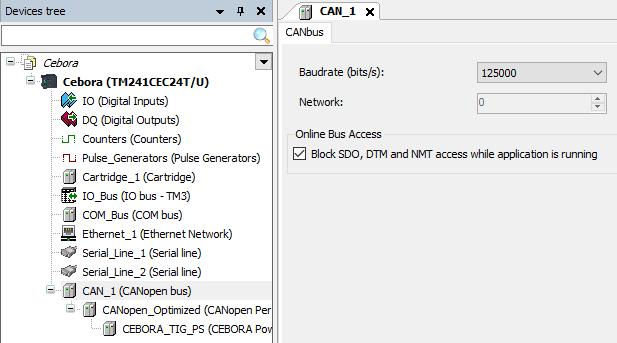
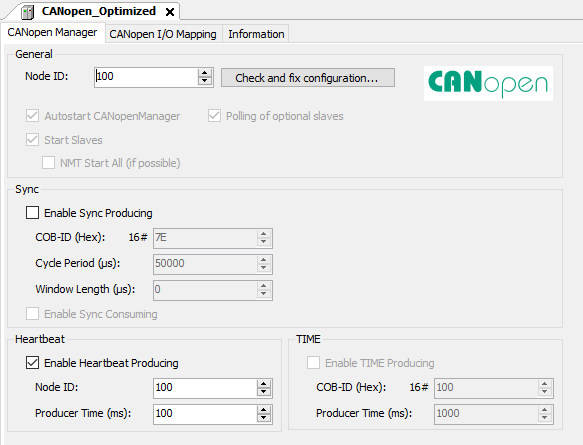
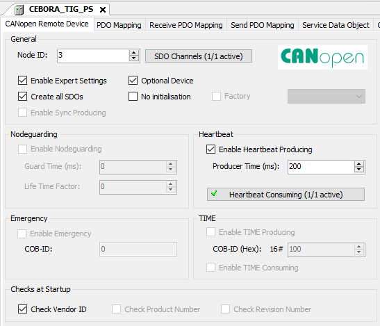
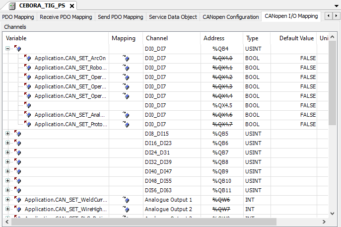
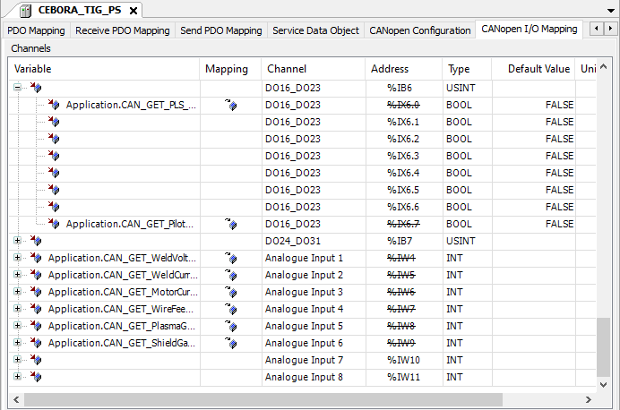

# Протокол обміну робот - контролер - джерело

Робот періодично надсилає кадр з командами (у прикладі програми кожні 0,1 с) і чекає відповідь. Контролер розбирає кадр, записує команди в змінні `CAN_SET_*`, які відображені на PDO джерела, і формує відповідь зі змінних `CAN_GET_*`.

## Порт

| Параметр | Значення |
|---|---|
| Інтерфейс | RS232, Serial Line 1 контролера |
| Швидкість | 19200 бод, 8 біт, без парності, 1 стоп-біт |
| ASCII Manager | Frame Length Received = 70, символи початку і кінця кадру не використовуються |
| Робот | порт `/dev/ttyS0`, `open(CeboraRS232,"/dev/ttyS0",19200,8,one,none)` |

Кадр визначається довжиною. Символи `S` і `F` лежать усередині даних і перевіряються програмою.

## Кадр робот - контролер, 70 байт

| Байти | Зміст | Приклад |
|---|---|---|
| 1 | початок кадру | `S` |
| 2-34 | 33 прапорці | `0` або `1` |
| 35-39 | струм зварювання, А | `00075` |
| 40-44 | швидкість дроту High, м/хв | `005.0`, `-05.0` |
| 45-49 | коефіцієнт імпульсу, % | `00050` |
| 50-54 | швидкість дроту Low, м/хв | `005.0`, `-05.0` |
| 55-59 | витрата плазмового газу, л/хв | `001.0` |
| 60-64 | витрата захисного газу, л/хв | `030.0` |
| 65-69 | випадкове число | `48271` |
| 70 | кінець кадру | `F` |

Випадкове число змінюється в кожному кадрі. Контролер за ним перевіряє, що робот живий.

### Прапорці, байти 2-34

| Байт | Параметр | Призначення |
|---|---|---|
| 2 | `Arc_On` | основна дуга |
| 3 | `RobotReady` | готовність робота |
| 4 | `OperMode_0` | режим роботи, біт 0 |
| 5 | `OperMode_1` | режим роботи, біт 1 |
| 6 | `OperMode_2` | режим роботи, біт 2. `OperMode_1` і `OperMode_2` разом вмикають режим TIG |
| 7 | `AnalogSwap` | режим Analog swap |
| 8 | `ProtocolMode` | режим протоколу, у бібліотеці робота завжди 0 |
| 9 | `GasTest` | продувка газу |
| 10 | `WireInching` | подача дроту |
| 11 | `WireRetract` | втягування дроту |
| 12 | `SourceErrReset` | скидання помилки джерела |
| 13 | `TouchSensing` | Touch Sensing |
| 14 | `BlowTrough` | Blow Through |
| 15-22 | `JOB_0`...`JOB_7` | номер завдання (JOB) |
| 23 | `WeldSim` | симуляція зварювання |
| 24-29 | `AnalogSetDis_0`...`AnalogSetDis_5` | дозвіл аналогових уставок |
| 30 | `DC_AC_Disable` | заборона перемикання DC / AC |
| 31 | `PLS_Disable` | заборона перемикання імпульсу |
| 32 | `DC_AC` | вибір DC / AC |
| 33 | `PLS` | імпульсний режим |
| 34 | `PilotArc` | чергова дуга |

## Кадр контролер - робот, 50 байт

| Байти | Зміст | Приклад |
|---|---|---|
| 1 | початок кадру | `S` |
| 2-19 | 18 прапорців | `0` або `1` |
| 20-24 | напруга дуги, В | `12.50` |
| 25-29 | струм зварювання, А | `75.00` |
| 30-34 | струм двигуна подачі, А | `01.20` |
| 35-39 | швидкість подачі дроту, м/хв | `-5.00` |
| 40-44 | витрата плазмового газу, л/хв | `01.00` |
| 45-49 | витрата захисного газу, л/хв | `30.00` |
| 50 | кінець кадру | `F` |

### Прапорці, байти 2-19

| Байт | Параметр | Призначення |
|---|---|---|
| 2 | `CurrFlow` | Current Flow |
| 3 | `ProcActive` | процес активний |
| 4 | `MainCurrent` | є основний струм |
| 5 | `CollisProtect` | спрацював захист від зіткнення |
| 6 | `PowSourReady` | джерело готове |
| 7 | `Commun_Ready` | зв'язок з джерелом готовий |
| 8-15 | `ErrNumber_0`...`ErrNumber_7` | номер помилки джерела, 8 біт |
| 16 | `PLS_Sync` | синхронізація імпульсу |
| 17 | `PilotArc` | є чергова дуга |
| 18 | `StikingRem` | Sticking Remedied |
| 19 | `WireAvailale` | дріт є |

Назви параметрів збігаються з іменами змінних у `src/GVL.st` і з іменами в бібліотеці `robot/Cebora.arl`.

## Масштабування

Джерело отримує і повертає значення у вигляді слова 0...65535. Контролер перераховує їх лінійно (функціональний блок `SE_TBX.FB_Scaling`).

| Параметр | Діапазон кадру | Слово CAN |
|---|---|---|
| Струм зварювання | 0...500 А | 0...65535 |
| Швидкість дроту High | -10...10 м/хв | 0...65535, нуль 32768 |
| Коефіцієнт імпульсу | 0...100 % | 0...65535 |
| Швидкість дроту Low | -10...10 м/хв | 0...65535, нуль 32768 |
| Витрата плазмового газу | 0...10 л/хв (бібліотека робота обмежує знизу 0,2) | 0...65535 |
| Витрата захисного газу | 0...30 л/хв (бібліотека робота обмежує знизу 5) | 0...65535 |

| Вимір | Слово CAN | Діапазон у кадрі |
|---|---|---|
| Напруга | 0...65535 | 0...100 В |
| Струм зварювання | 0...65535 | 0...1000 А |
| Струм двигуна | 0...65535 | 0...5 А |
| Швидкість подачі дроту | 0...65535 | -12,5...12,5 м/хв |
| Плазмовий газ | 0...65535 | 0...10 л/хв |
| Захисний газ | 0...65535 | 0...30 л/хв |

## Захист від обриву зв'язку

Контролер порівнює випадкове число з поточного кадру з попереднім. Якщо воно не змінюється 3 с (таймер `T4`), змінна `STOP_Read` обнуляє весь буфер приймання. Усі прапорці і уставки скидаються, джерело зупиняється.

## Сумісна робота з іншою системою керування

Вхід `IX0.0` контролера підключено до сигналу від ПЛК комплексу ЛПЗР, який керує тим самим джерелом. Коли сигнал є, обмін у `ConvToCAN` не виконується: контролер не читає кадри від робота і не змінює команди для джерела. Коли сигналу немає, керування джерелом повертається роботу.

## Таймери обміну

Програма `Timers` (FBD) формує вікна читання і відправлення в межах одного циклу обміну. Це ланцюжок TON з витримками 10, 40, 10 і 20 мс (`T0`...`T3`) і таймер захисту `T4` на 3 с. Програма `ConvToCAN` викликає `Timers()` перед кожною перевіркою вікна і за станами `T0_STATE`, `T1_STATE`, `T2_STATE` запускає `SndRecvRS232` на читання або запис.

## CANopen

| Параметр | Значення |
|---|---|
| Шина | CAN_1, 125 кбіт/с |
| Контролер | майстер, Node ID 100, heartbeat 100 мс |
| Джерело | слейв, Node ID 3, EDS `CEBORA_TIG.eds`, heartbeat 200 мс |

Змінні `CAN_SET_*` відображені на дискретні (`DI0...DI63`) і аналогові (`Analogue Output 1...6`) виходи PDO джерела. Змінні `CAN_GET_*` відображені на дискретні (`DO0...DO31`) і аналогові (`Analogue Input 1...6`) входи.

